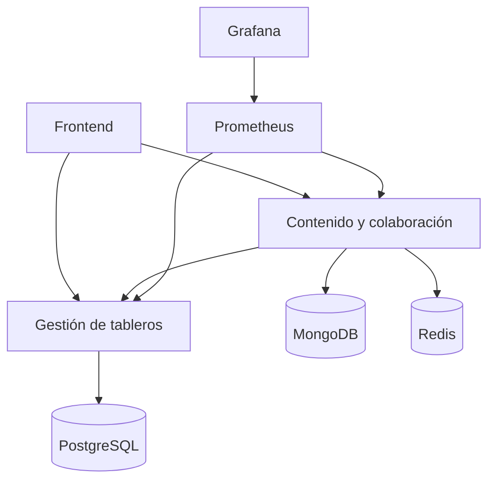

# Entrega ARSW-EQP-03 · Persistencia, consistencia y observabilidad

Integrantes: Sara Arteaga, Johan Beltrán y Julián Tinjacá

Este repositorio contiene nuestra solución al laboratorio de persistencia y consistencia de Arquitecturas de Software. El objetivo fue decidir qué motor de datos usar para cada tipo de información de un tablero colaborativo y comprobar con pruebas y métricas que la arquitectura cumple lo que promete, no solo que responde rápido.

Trabajamos con PostgreSQL para los permisos, MongoDB para el contenido del tablero y Redis para la presencia y una caché de permisos, todo sobre Docker Compose y observado con Prometheus, Grafana y k6. Partimos de un código que tenía tres defectos: se podían perder ediciones cuando dos personas guardaban al mismo tiempo, un usuario revocado podía seguir escribiendo gracias a la caché y la presencia nunca expiraba.

Lo que hicimos:

- Implementamos control optimista de versiones en MongoDB, de modo que de dos ediciones con la misma versión solo una se guarda y la otra recibe 409.
- Hicimos que las escrituras siempre validen el permiso contra Gestión y PostgreSQL. Un usuario revocado recibe 403 y si Gestión no responde se devuelve 503 sin guardar.
- Registramos la presencia con una expiración de 20 segundos y, si Redis se cae, la presencia se degrada sin afectar la edición del tablero.
- Probamos fallos controlados apagando Redis y Gestión, medimos carga con k6 y armamos un dashboard en Grafana con ocho paneles más uno opcional.

Dónde está cada cosa:

- Código modificado: services/content/decisions.py
- Matriz de decisiones: entrega/MATRIZ.md
- ADR: entrega/ADR-001.md
- Registro de evidencias y respuestas de observabilidad: entrega/EVIDENCIAS.md
- Dashboard exportado: entrega/dashboard.json
- Resultados de pruebas y capturas: entrega/evidencias

Para reproducirlo basta con levantar el entorno con docker compose up -d --build --wait y correr docker compose run --rm tools acceptance. Abajo se conserva el enunciado original del laboratorio.

---

# ARSW · Laboratorio de persistencia, consistencia y observabilidad

**Escuela Colombiana de Ingeniería Julio Garavito**  
Arquitecturas de Software · 2026-2 · Profesor Javier Iván Toquica  
**Duración:** 150 minutos · **Modalidad:** equipos habituales, entrega en clase

> **Reto:** un tablero puede responder rápido y aun así perder una edición, aceptar un permiso revocado o depender innecesariamente de una caché. Su trabajo es elegir y comprobar qué debe garantizar la arquitectura.

## 1. Qué aprenderán y qué entregarán

Al finalizar podrán:

- Justificar PostgreSQL, MongoDB y Redis según operaciones, integridad, estructura y vida útil del dato.
- Evitar ediciones perdidas mediante control optimista de versiones.
- Separar una caché útil de una fuente válida para autorizar escrituras.
- Diseñar una capacidad temporal que se degrade sin detener el flujo principal.
- Relacionar pruebas funcionales con métricas de Prometheus y tableros de Grafana.

**Entrega en clase:** repositorio con los cambios, matriz de decisiones, un ADR, evidencias antes/después y dashboard exportado. Los puntos del taller están integrados en el laboratorio; no hay un taller adicional.

## 2. Continuidad con las clases anteriores

De la clase de NoSQL retomamos: consultas que orientan el modelo; embeber/referenciar; atomicidad; versiones; garantías por operación. Del laboratorio de calidad retomamos: **Prometheus recopila métricas, Grafana las presenta y k6 genera carga**.

Material anterior: [laboratorio de observabilidad y rendimiento](https://github.com/javi-toquica/lab-arsw-quality-attr-observability-performance).

Ahora agregamos una pregunta: **¿la respuesta contiene un resultado correcto y autorizado?** Un HTTP 200 y un P95 bajo no lo demuestran por sí solos.

Este Compose contiene instancias únicas. **No demuestra replicación, consenso ni el teorema CAP**. Detener Redis es una falla de dependencia, no una partición entre réplicas. La consistencia de esta práctica se observa en ediciones, caché y revocación de permisos.

## 3. Arquitectura inicial y decisiones abiertas

Hay **dos servicios de negocio**, más infraestructura y un frontend estático:



Las flechas de Prometheus representan consultas de métricas. El acceso del frontend a Gestión administra **solo el escenario ficticio del laboratorio**.

| Componente | Estado suministrado | Trabajo del equipo |
|---|---|---|
| Gestión / PostgreSQL | Usuarios, tableros y membresías; claves y relaciones | Justificar integridad y demostrar restricciones/rollback |
| Contenido / MongoDB | Documento con título, preferencias y versión | Corregir actualización condicionada por versión; decidir qué embeber |
| Colaboración / Redis | Caché de permisos y presencia | Separar autorización de caché; TTL; degradación |
| Prometheus / Grafana | Scraping y dos paneles iniciales | Construir seis paneles y explicar resultados |
| Frontend | Dos identidades ficticias y controles del escenario | Reproducir y explicar defectos desde dos pestañas |

Esta distribución permite arrancar sin escribir adaptadores. **Es una hipótesis a defender, no la respuesta de la matriz.** Comparen al menos una alternativa, por ejemplo PostgreSQL con JSONB frente a MongoDB, o eliminar Redis y asumir sus consecuencias. No se exige migrar entre motores durante la clase.

El historial creciente se diseña en el ADR (colección/tabla separada, consulta y paginación); no se implementa un historial ilimitado dentro del documento.

## 4. Condiciones y preparación

- Equipos habituales. Todos deben poder explicar una decisión y una evidencia.
- Docker Engine/Desktop **en ejecución** y Docker Compose v2 con soporte de `--wait`.
- Git o descarga del ZIP, navegador, editor de texto. **No necesitan Python, Node ni bases instalados en el equipo.**
- Primera ejecución requiere Internet para imágenes y paquetes. Como punto de partida asignen unos 6 GB de RAM a Docker y dejen espacio para imágenes; depende del equipo.
- Usar solamente los datos ficticios incluidos. Las identidades `ana` y `luis` se simulan con un header: **no hay autenticación de producción**.
- Puertos web publicados en `127.0.0.1`; bases sin puertos publicados. No exponer este entorno a Internet.
- Imágenes y dependencias fijadas para la práctica; no constituyen una selección de versiones para producción.
- Se permite consultar documentación y usar asistentes, pero deben declarar el apoyo en el ADR y explicar el código entregado.

### Arranque (macOS/zsh, Linux o terminal de VS Code)

Descomprima el ZIP, abra la carpeta `lab-arsw-persistencia` y ejecute:

```sh
docker --version
docker compose version
docker compose up -d --build --wait --wait-timeout 180
docker compose ps
docker compose run --rm tools smoke
```

Los valores de laboratorio funcionan sin `.env`. Para personalizar puertos o claves, copie `.env.example` como `.env` antes de arrancar (`cp .env.example .env`; PowerShell: `Copy-Item .env.example .env`).

| Acceso | URL / credenciales predeterminadas |
|---|---|
| Aplicación | http://localhost:8080 |
| Grafana | http://localhost:3000 · `admin` / `lab-grafana` |
| Prometheus | http://localhost:9090 · estado de targets: `/targets` |
| API Contenido | http://localhost:8080/api/openapi.json |
| API Gestión | http://localhost:8080/management/openapi.json |
| Administración del escenario | Clave `lab-admin` en el frontend |

Grafana trae la fuente **Prometheus** y la carpeta **ARSW**. Espere 15–30 s para el primer scraping; genere tráfico para que aparezcan métricas HTTP. Un arranque lento puede requerir ampliar `--wait-timeout` a 300.

## 5. Plan de trabajo · 2 horas y 30 minutos

| Minutos | Bloque | Resultado verificable |
|---|---|---|
| 0–15 | Arranque y recorrido | Smoke correcto; frontend; targets disponibles |
| 15–35 | Decidir el almacenamiento | Matriz inicial + evidencia SQL |
| 35–75 | Implementar tres decisiones | Cambios en `services/content/decisions.py` |
| 75–105 | Probar fallos y garantías | JSON antes/después, Redis detenido y restaurado |
| 105–135 | Observar bajo carga | Dashboard propio + k6 carga + interpretación |
| 135–150 | Consolidar y entregar | ADR, evidencia y enlace del repositorio |

## 6. Bloque A · Elegir antes de corregir

Complete [la matriz](entrega/MATRIZ.md) para: membresías/permisos, contenido, preferencias, historial, presencia y caché de permisos. Incluya motor, consulta principal, atomicidad, tolerancia al atraso, duración y consecuencia de perder el dato.

**Demostración SQL:** ejecute el archivo dentro del contenedor:

```sh
docker compose exec -T postgres psql -U lab -d boards -f /lab/evidence.sql
```

El archivo está montado por Compose. Verá dos errores **esperados**, uno de clave única y otro de clave foránea, dentro de transacciones revertidas. También verá una revocación revertida con `ROLLBACK`. Guarde la salida o una captura y explique qué garantiza cada restricción. No elimine restricciones para hacer que los errores desaparezcan.

Para inspeccionar el documento y las claves:

```sh
docker compose exec mongo mongosh boards --quiet --eval 'db.documents.findOne({_id:"board-1"})'
docker compose exec redis redis-cli --scan
```

**Preguntas integradas:** ¿qué gana y qué cuesta embeber preferencias? ¿Qué ocurre si el historial crece sin límite? ¿Podría PostgreSQL resolver también el documento? ¿Por qué no guardar permisos únicamente en Redis?

## 7. Bloque B · Medir la base y completar tres TODO

Antes de editar:

```sh
docker compose run --rm tools baseline
```

Tarda unos 22 s por la expiración. Guarda `results/baseline-<fecha>.json`. Es normal encontrar `passed: false` en conflictos, revocación y expiración. El comando baseline registra esos defectos y sale con código 0; un error de arranque/ejecución sí produce código 1.

### TODO 1 · Evitar una edición perdida

Archivo: `services/content/decisions.py`, función `save_board`.

Dos clientes leen versión 1 y envían cambios. **Solo uno debe guardar; el otro debe recibir HTTP 409.** Compare versión e increméntela dentro de la misma operación de MongoDB. Un `find` seguido de `update` sin condición atómica mantiene la carrera.

### TODO 2 · Revocación frente a caché

Función `permission_for_write`.

La consulta de permisos para la interfaz admite caché de 60 s. Para una **nueva escritura que comienza después de confirmar la revocación**, el servidor debe validar la autoridad y rechazar a Luis con 403. Si no puede validar, responder 503 y no guardar.

Decida entre los callbacks suministrados y justifique el costo. No basta con ocultar un botón ni con acortar el TTL. Esta práctica no resuelve la carrera de una revocación que ocurre **después** de validar y **antes** de guardar: Gestión y Contenido no comparten una transacción. Documente ese límite y una alternativa de diseño.

### TODO 3 · Presencia efímera y Redis opcional

Función `touch_presence`.

Registre la presencia con expiración de **20 s**, en una única escritura. Cada heartbeat renueva el TTL. Si Redis no responde, devuelva `False`: el endpoint responderá 200 con `available:false`; el contador de degradación debe aumentar. No diga que hay presencia disponible cuando no se pudo registrar.

El contenido y las ediciones válidas deben seguir funcionando si PostgreSQL, MongoDB y Gestión están disponibles.

**Aplicar cambios:** el código está montado, pero no usa recarga automática:

```sh
docker compose restart content
docker compose run --rm tools acceptance
```

Acceptance debe terminar con **todos los `passed: true` y código 0**. Reiniciar content reinicia sus contadores en memoria; Prometheus conserva muestras. `rate` maneja los reinicios, pero compare ventanas claramente identificadas.

## 8. Bloque C · Fallos controlados y evidencia

Realice las pruebas de manera secuencial; no ejecute reset, k6 ni otras ediciones mientras corre acceptance. Detenga cualquier clic repetido de presencia durante la prueba de expiración.

### Experimento 1 · Dos pestañas

Abra el frontend dos veces. Cargue la misma versión en ambas; en la segunda seleccione Luis. Guarde en la primera y luego en la segunda. Después de TODO 1 verá 200 y 409. Capture ambos resultados y explique por qué un 409 esperado no es una caída del servidor.

### Experimento 2 · Redis detenido

```sh
docker compose run --rm tools reset
docker compose stop redis
docker compose run --rm tools redis-down
docker compose start redis
```

Incluso si una prueba falla, **ejecute el último comando para restaurar Redis**. En Grafana observe `lab_dependency_up`: Redis baja a 0; los dos servicios pueden seguir con `up=1`. Tras corregir TODO 3, edición 200 y presencia 200/degradada. Un `up=1` solo prueba que Prometheus pudo obtener métricas.

Espere unos segundos y verifique:

```sh
docker compose exec redis redis-cli ping
docker compose run --rm tools acceptance
```

### Experimento 3 · Autoridad de permisos no disponible

Con Redis y Gestión funcionando, prime el permiso de Ana en la interfaz usando «Consultar permiso en caché». Luego:

```sh
docker compose stop management
docker compose run --rm tools authority-down
docker compose start management
```

Se espera **503**, aunque exista un permiso cacheado. Restaurar Gestión es obligatorio. Si Nginx queda con una IP antigua tras recrear contenedores, reinícielo con `docker compose restart frontend`.

**Preguntas:** ¿qué funcionalidad degradó de forma controlada? ¿Cuál dejó de estar disponible deliberadamente? ¿Qué garantía protege ese comportamiento? ¿Qué cambia si la falla es MongoDB?

## 9. Bloque D · Prometheus, Grafana y k6

1. Abra **ARSW · Punto de partida** en Grafana.
2. Guarde una copia con nombre **ARSW-EQP-XX · Persistencia** (Save as / Guardar como).
3. Mantenga los dos paneles iniciales y añada los seis de [OBSERVABILIDAD.md](docs/OBSERVABILIDAD.md).
4. Ejecute la carga dos veces: una con la base y otra con su solución si conservó la primera medición. Si no la conservó, informe solo la medición disponible; no invente resultados.

```sh
docker compose run --rm k6
```

Dura **100 s**, con 5 usuarios virtuales en la meseta. El resumen queda en `results/k6-carga-summary.json` y se sobrescribe en la siguiente carga: renómbrelo antes de comparar. El script usa únicamente lecturas para no mezclar la carga con las pruebas de concurrencia.

Para conservar además puntos crudos:

```sh
docker compose run --rm k6 run --out json=/results/k6-carga-points.json /scripts/workload.js
```

Los JSON son evidencia de k6. **Grafana no los importa como dashboard**: en esta práctica muestra las métricas HTTP que la aplicación expone y Prometheus recopila durante la carga. El P95 de k6 mide el recorrido del cliente; el de la aplicación mide su procesamiento y se estima con buckets. No tienen por qué coincidir.

Se suministran las otras pruebas para extensión, **no son obligatorias dentro de los 150 minutos**:

```sh
docker compose run --rm -e TYPE=estres k6
docker compose run --rm -e TYPE=pico k6
docker compose run --rm -e TYPE=resistencia k6
```

Estrés: 10→30→60 VU; pico: 2→40→2; resistencia: 5 minutos sostenidos más rampas. Son ensayos didácticos breves: el último no demuestra estabilidad de horas y el estrés puede no saturar su equipo. Los umbrales (`P95<500 ms`, errores<1%) son hipótesis de clase, no resultados garantizados. Un umbral incumplido debe explicarse; no se penaliza un equipo lento por sí mismo.

## 10. Entrega y evaluación · sobre 5,0

Complete `entrega/MATRIZ.md`, `entrega/ADR-001.md` y `entrega/EVIDENCIAS.md`. Copie manualmente los JSON seleccionados a `entrega/evidencias/` (results está excluido de Git), exporte su dashboard a `entrega/dashboard.json` y agregue capturas con ventana horaria visible.

| Criterio | Peso | Evidencia |
|---|---:|---|
| Decisiones de datos y modelo | 1,0 | Matriz completa, alternativa y restricciones SQL |
| Versiones y permisos | 1,5 | Cambios justificados; conflicto 409 y revocación 403 |
| TTL y degradación | 1,0 | Expiración, caída Redis, autoridad caída y restauración |
| Observabilidad y carga | 1,0 | Ocho paneles totales, resumen k6 e interpretación |
| ADR y reproducibilidad | 0,5 | Instrucciones, consecuencias, límite de revocación y participación |
| **Total** | **5,0** | |

**Criterio de cierre:** acceptance, redis-down y authority-down pasan; se conserva evidencia de los defectos de la base; nadie confunde errores de negocio con 5xx ni `up` con disponibilidad funcional. Si no completan una corrección, entreguen el intento, evidencia y diagnóstico; no cambien las pruebas para ocultarlo.

En Teams entregue el enlace del repositorio público o con acceso al profesor y el commit final. No incluya `.env` ni credenciales reales. El responsable de publicación es el equipo; todos deben participar.

## 11. Operación y solución de problemas

```sh
# Ver errores y estado
docker compose ps
docker compose logs --tail=80 content management
# Reiniciar solo datos ficticios del escenario (con dependencias disponibles)
docker compose run --rm tools reset
# Detener conservando datos y dashboards
docker compose down
# Volver a iniciar
docker compose up -d --wait --wait-timeout 180
```

- **Puerto ocupado:** cambie los puertos en `.env` y vuelva a ejecutar `up -d`; use las nuevas URLs. Las herramientas internas no requieren cambiar BASE_URL.
- **Docker no responde:** abra Docker Desktop o inicie Docker Engine y vuelva a intentar.
- **Sin datos en Grafana:** revise `/targets`, genere peticiones y use «últimos 15 min»; espere al menos dos scrapes. Counters aparecen cuando ocurre el primer evento.
- **Cambios no aplicados:** `docker compose restart content`; modificar requirements exige `up -d --build`.
- **503 luego de pruebas:** `docker compose start redis management`; revise MongoDB/PostgreSQL y los logs.
- **Servicios recreados / 502:** `docker compose restart frontend` para resolver nombres nuevamente.
- **Exportación de dashboard:** exporte JSON completo; si Grafana ofrece exportación para compartir externamente, deje esa opción desactivada para conservar el UID de la fuente `prometheus`.
- **Permisos de archivos Linux:** k6 corre como root dentro del contenedor para escribir el volumen; si crea resultados propiedad de root, cambie propietario desde el host antes de editar, o copie la evidencia con permisos adecuados.
- **Mongo en equipos antiguos:** MongoDB requiere CPU compatible; use un equipo compatible del grupo si el contenedor termina por instrucciones no soportadas.

**Borrado total opcional:** `docker compose down -v` elimina volúmenes de PostgreSQL, MongoDB, Prometheus y Grafana de este proyecto. Exporte evidencia y dashboard antes. El SQL de inicialización solo se aplica en un volumen PostgreSQL nuevo.

## 12. Alcance y referencias

No hay transacciones distribuidas, autenticación real, alta disponibilidad ni réplicas configuradas. Un `GET` de tablero es público en esta demo; se protege la edición. La prueba de carga comprueba estructura y versión válida, pero no prueba por sí sola consistencia: para eso están los escenarios de aceptación.

- [Docker Compose: orden y healthchecks](https://docs.docker.com/compose/how-tos/startup-order/)
- [MongoDB: atomicidad de operaciones](https://www.mongodb.com/docs/manual/core/write-operations-atomicity/)
- [Redis: SET y expiración](https://redis.io/docs/latest/commands/set/)
- [PostgreSQL: restricciones](https://www.postgresql.org/docs/16/ddl-constraints.html)
- [Prometheus: histogramas](https://prometheus.io/docs/practices/histograms/)
- [Grafana: provisioning](https://grafana.com/docs/grafana/latest/administration/provisioning/)
- [k6: escenarios](https://grafana.com/docs/k6/latest/using-k6/scenarios/)

Preparado para la clase del 31 de octubre de 2026. Véase [VALIDACION.md](docs/VALIDACION.md) para el alcance de las verificaciones del paquete.
